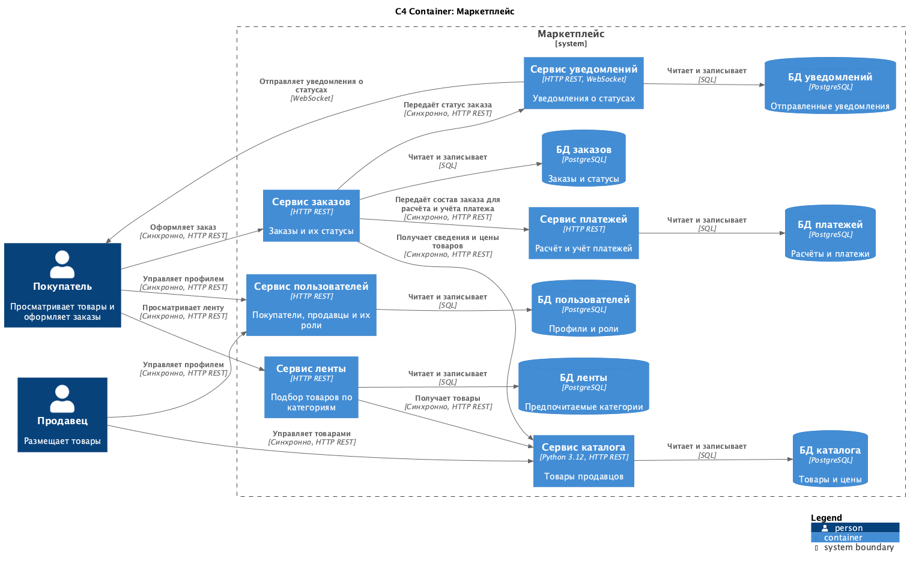

# Архитектура маркетплейса

Маркетплейс позволяет продавцам размещать товары, а покупателям просматривать ленту и оформлять заказы. Проект охватывает управление пользователями, каталогом, заказами и платежами, а также уведомления о статусах заказов. Ниже показана C4 Container диаграмма выбранной архитектуры; её [исходник — C4-PlantUML](architecture.puml).



## Домены, сервисы и владение данными

| Домен | Сервис | Ответственность | Собственные данные |
| --- | --- | --- | --- |
| Пользователи | Сервис пользователей | Управление покупателями, продавцами и их ролями | Профили пользователей и роли |
| Каталог | Сервис каталога | Управление товарами продавцов и выдача сведений о товарах | Карточки товаров, текущие цены, принадлежность продавцам |
| Лента | Сервис ленты | Выдача товаров по выбранным покупателем категориям | Предпочитаемые категории покупателей |
| Заказы | Сервис заказов | Оформление заказов и ведение их статусов | Заказы, состав заказа, цена на момент заказа, статус |
| Платежи | Сервис платежей | Расчёт суммы и учёт платежей по заказам | Рассчитанные суммы и записи платежей |
| Уведомления | Сервис уведомлений | Отправка покупателю сведений об изменении статуса заказа | Записи об отправленных уведомлениях |

Если покупатель не выбрал категории, лента показывает товары без персонального отбора. Это минимальная степень персонализации для требования задания. Базы данных у сервисов отдельные; другой сервис получает сведения только через контракт владельца данных, а не напрямую из его базы. Хранилища показаны как проектное решение и в текущем коде не поднимаются.

## Взаимодействия

Все связи между сервисами в выбранном варианте синхронные, через HTTP REST. Сервис ленты запрашивает товары у каталога. Сервис заказов получает у каталога сведения и цену товара, передаёт сервису платежей состав заказа для расчёта и учёта платежа, а при изменении статуса обращается к сервису уведомлений. Сервис уведомлений передаёт статус покупателю через WebSocket. Вызов уведомлений выполняется после сохранения статуса заказа: недоступность уведомлений не отменяет уже сохранённый статус, но может задержать сообщение покупателю. Стрелки и направления показаны на диаграмме выше.

## Варианты разбиения и компромиссы

| Вариант | Плюсы | Минусы |
| --- | --- | --- |
| Модульный монолит: шесть доменных модулей в одном приложении с одной базой | Один процесс и одно развёртывание; вызовы между модулями не требуют сети; операции с данными проще согласовывать | Изменение ленты или каталога требует выпуска всего приложения; отдельные домены нельзя развёртывать и масштабировать независимо; данные платежей находятся в общей базе приложения |
| Шесть сервисов по доменам, каждый со своей базой | У каждого домена и его данных один владелец; ленту можно развивать и масштабировать отдельно; данные платежей физически отделены; сервисы можно выпускать независимо при сохранении контрактов | Шесть развёртываний и баз обходятся дороже; сетевые вызовы добавляют задержку и ошибки; согласование заказа и платежа сложнее, чем в одном процессе; синхронные вызовы создают временную зависимость между сервисами |

**Выбран второй вариант.** Лента может меняться чаще остальных частей системы, а платежи содержат данные, которым полезна отдельная граница владения. Разбиение по доменам сохраняет связанную логику внутри каждого сервиса и позволяет независимо развивать каталог, заказы и платежи. Для текущего этапа это проект архитектуры, а не реализация всей распределённой системы: задание требует запустить только один сервис без бизнес-логики. Цена выбора — дополнительные развёртывания и сетевые зависимости; она отражена в таблице выше.

## Запуск обязательного сервиса

Сервис каталога сейчас содержит только `GET /health`. Он не управляет товарами и не обращается к базе данных.

```sh
docker build -t marketplace-catalog .
docker run --rm -p 8000:8000 marketplace-catalog
```

В другом терминале:

```sh
curl -i http://localhost:8000/health
```

Ожидаемый статус ответа: `HTTP/1.0 200 OK`; тело ответа: `OK`.
