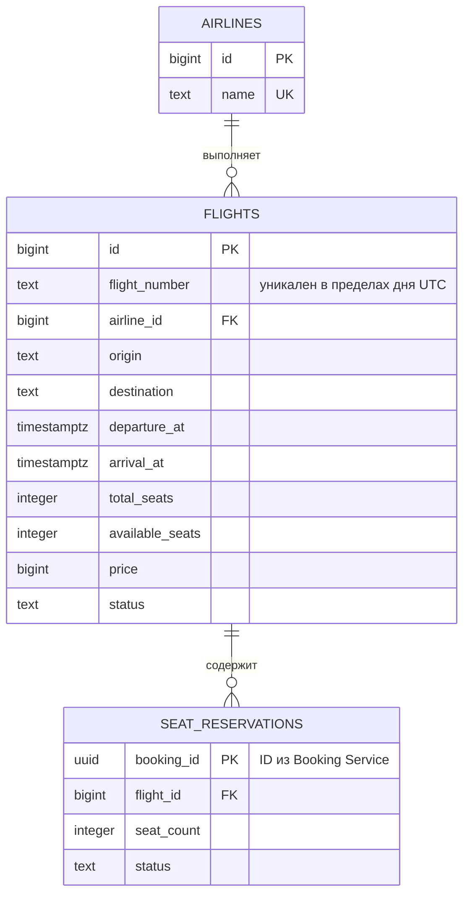
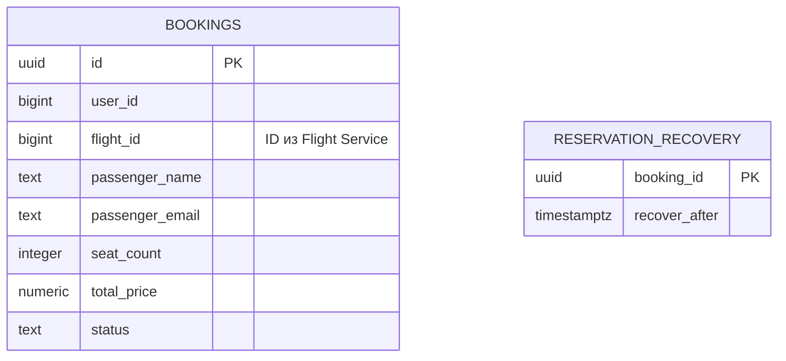

# ДЗ №3. Flight Booking

Два сервиса на Python 3.11. Booking Service принимает REST-запросы, Flight Service отвечает по gRPC. У каждого сервиса своя PostgreSQL. Для кеша рейсов используется Redis Sentinel.

## Запуск

В каталоге `homework-3` выполните команду.

```sh
docker compose up --build
```

Booking API доступен на порту 8083. При старте Flyway применяет миграции и добавляет учебный рейс SVO → LED на 1 апреля 2026 года.

## Booking Service

| Метод | Путь | Назначение |
| --- | --- | --- |
| GET | `/flights?origin=SVO&destination=LED&date=2026-04-01` | Поиск рейсов со статусом SCHEDULED. Дата опциональна |
| GET | `/flights/{id}` | Получение рейса |
| POST | `/bookings` | Создание бронирования |
| GET | `/bookings/{id}` | Получение бронирования |
| POST | `/bookings/{id}/cancel` | Отмена подтверждённого бронирования |
| GET | `/bookings?user_id=1` | Бронирования пользователя |

```sh
curl 'http://localhost:8083/flights?origin=SVO&destination=LED&date=2026-04-01'

curl -X POST http://localhost:8083/bookings \
  -H 'Content-Type: application/json' \
  -d '{"user_id":1,"flight_id":1,"passenger_name":"Иван Иванов","passenger_email":"ivan@example.com","seat_count":2}'
```

День вылета определяется по UTC. `price` и `total_price` указаны целым числом копеек. При создании бронирования Booking Service получает цену через `GetFlight`, резервирует места через `ReserveSeats` и сохраняет итоговую стоимость. При отмене вызывает `ReleaseReservation` и меняет статус на `CANCELLED`.

Если Booking Service зарезервировал места, но не сохранил бронирование, фоновая задача снимает резерв. При успешном создании сервис сохраняет бронирование и удаляет запись из журнала в одной транзакции.

## Flight Service

При сборке образа `protoc` генерирует Python-код клиента и сервера. Booking Service передаёт `FLIGHT_API_KEY` в metadata `x-api-key` при каждом вызове. [Контракт gRPC](proto/flight.proto)

Кеш хранится 5 минут. При изменении рейса удаляются его карточка и результаты поиска с датой вылета и без даты. В логах Flight Service видны `cache hit` и `cache miss`.

Booking Service повторяет вызов при `UNAVAILABLE` и `DEADLINE_EXCEEDED`. Максимум три попытки с паузами 100 и 200 мс. В состоянии `HALF_OPEN` интерсептор пропускает один пробный вызов. Порог ошибок, время в состоянии OPEN и окно подсчёта задаются через `CIRCUIT_FAILURE_THRESHOLD`, `CIRCUIT_OPEN_SECONDS` и `CIRCUIT_WINDOW_SECONDS`. Переходы видны в логах Booking Service.

## ER-диаграмма

### Flight Service



### Booking Service



Служебная таблица `reservation_recovery` хранит идентификатор незавершённой операции и время следующей попытки компенсации.

У бронирования одна резервация, связанная по `bookings.id = seat_reservations.booking_id`. Межсервисные идентификаторы хранятся как обычные поля. Название авиакомпании хранится в `airlines`. Данные пассажира и итоговая цена фиксируются в конкретном бронировании. Ограничения количества мест, цены и статусов заданы в [миграциях Flight Service](migrations/flight/V1__schema.sql) и [миграции Booking Service](migrations/booking/V1__schema.sql).
